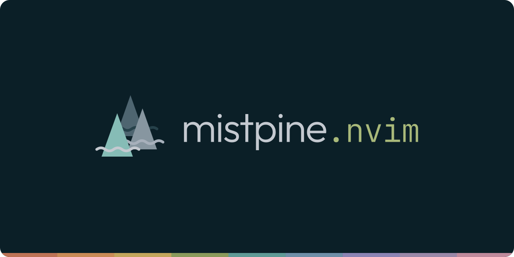
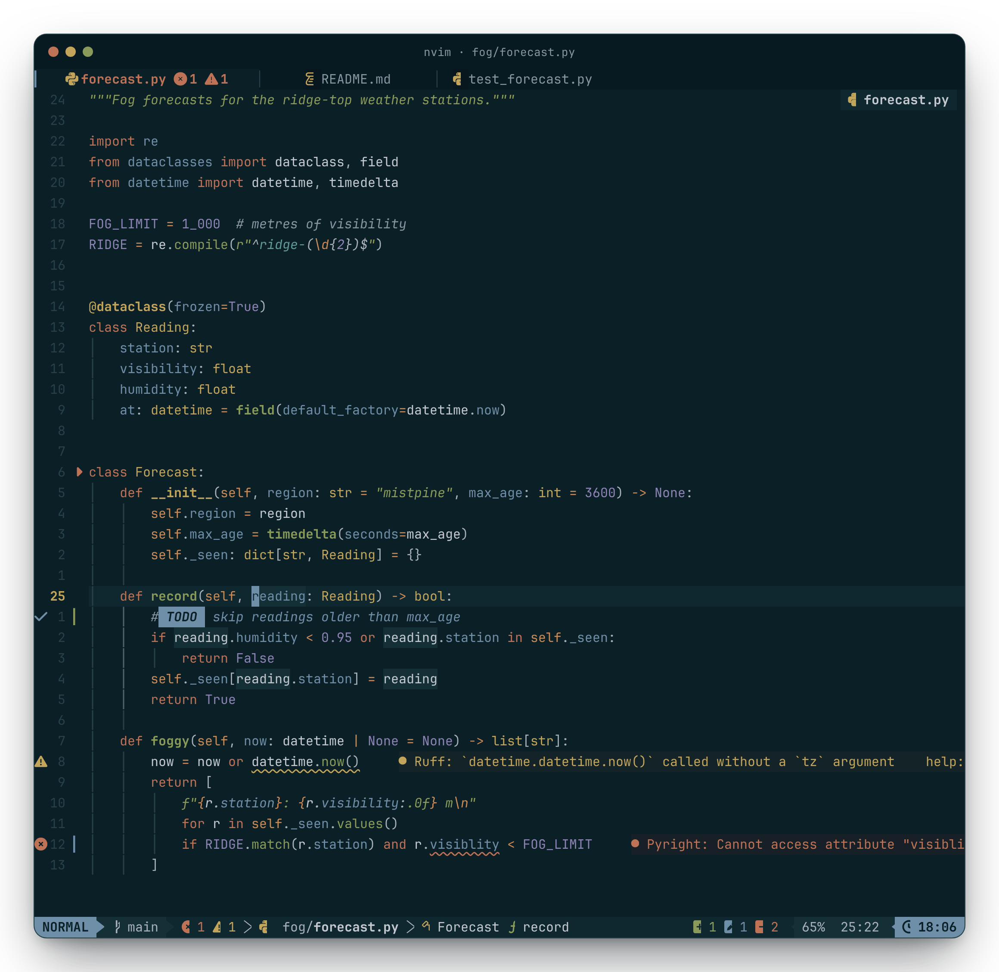
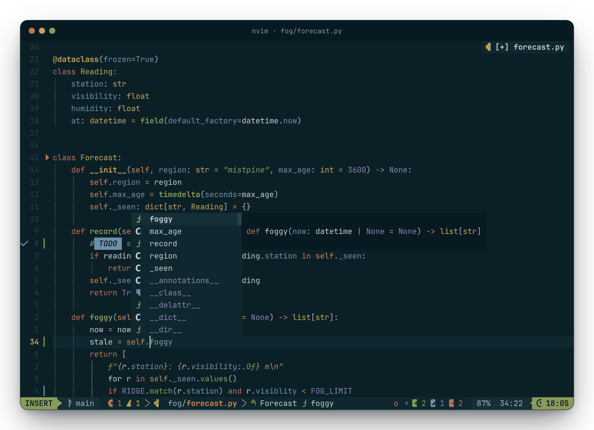
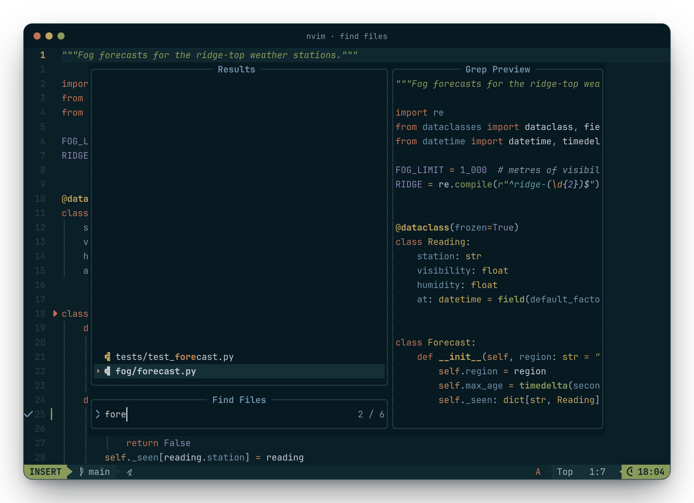
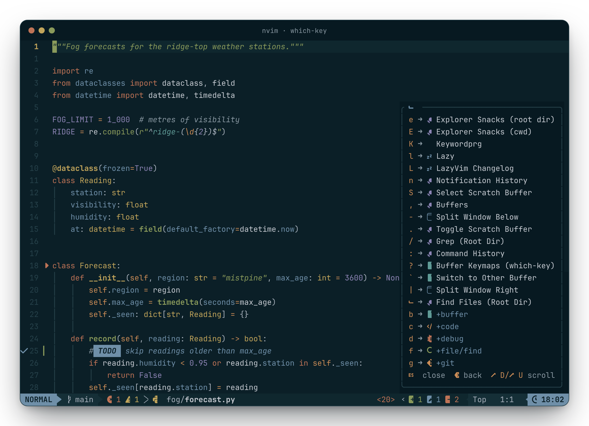
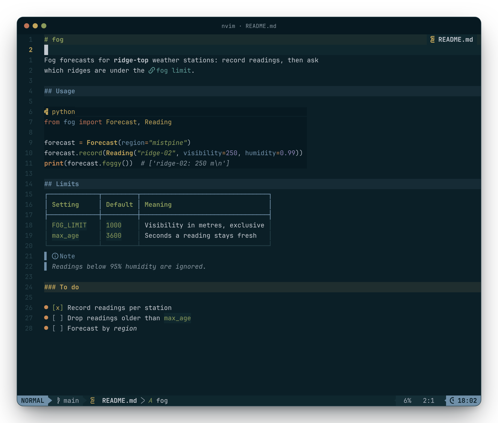
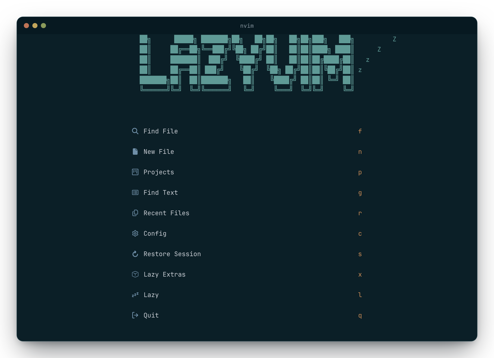
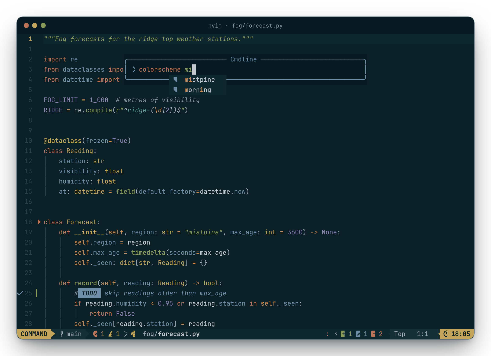

<p align="center">
  
</p>

<p align="center">
  
</p>

**mistpine.nvim** is the Neovim port of [mistpine](https://github.com/lnutimura/mistpine):
cool, misty grays over a deep blue-green night, with muted, earthy accents.
It implements the [mistpine spec](https://github.com/lnutimura/mistpine/blob/main/docs/spec.md)
exactly. Every color is a palette color or one of the spec's blends, and every
syntax and diagnostic color clears 4.5:1 on the background.

- Neovim 0.10 or newer, tested on 0.10, 0.11, 0.12 and nightly
- Tree-sitter captures, LSP semantic tokens, diagnostics, inlay hints, diff and `:checkhealth`
- A lualine theme, picked up by `theme = "auto"`
- Terminal colors for `:terminal`
- Integrations for blink.cmp, bufferline.nvim, flash.nvim, gitsigns.nvim, grug-far.nvim,
  incline.nvim, lazy.nvim, mason.nvim, mini.icons, noice.nvim, render-markdown.nvim,
  snacks.nvim, telescope.nvim, trouble.nvim, which-key.nvim and zen-mode.nvim

## Install

With [lazy.nvim](https://github.com/folke/lazy.nvim):

```lua
{
  "lnutimura/mistpine.nvim",
  lazy = false,
  priority = 1000,
  opts = {},
  config = function(_, opts)
    require("mistpine").setup(opts)
    vim.cmd.colorscheme("mistpine")
  end,
}
```

In LazyVim, add the spec above without `config` and set
`{ "LazyVim/LazyVim", opts = { colorscheme = "mistpine" } }`.

## Options

`setup()` is optional. These are the defaults:

```lua
require("mistpine").setup({
  transparent = false, -- leave the editor background to the terminal
  dim_inactive = false, -- recessed background for inactive windows
  terminal_colors = true, -- g:terminal_color_0 … g:terminal_color_15
  italic = true, -- comments and strings
  bold = true, -- functions and headings
  plugins = { all = true }, -- or { all = true, telescope = false }
  on_colors = function(palette) end, -- change palette colors, e.g. palette.bg1 = "#000000"
  on_highlights = function(highlights, colors) end, -- change groups before they are set
})
```

Colors derived from a palette color follow it: changing `bg1` in `on_colors`
moves the editor background and recomputes the search and diff blends.
`require("mistpine").colors()` returns the resolved colors for your own
statusline or plugins (see `:help mistpine.nvim`). mistpine is dark only: `:set background=light` turns it
off, as Vim does for dark-only schemes.

## Screenshots

| | |
| :-: | :-: |
|  |  |
|  |  |
|  |  |

## Development

```sh
make test          # unit tests, or: nvim --clean --headless -l tests/run.lua
make test-plugins  # real plugins (clones into .cache/plugins)
make sync          # palette.lua from the mistpine spec
make images        # README images (pnpm install first; Node 24+, Chromium)
```

`lua/mistpine/palette.lua` is generated from
[`palette/mistpine.json`](https://github.com/lnutimura/mistpine/blob/main/palette/mistpine.json);
change colors upstream, then sync. Screenshots come from a real Neovim: `pnpm render` runs
an isolated LazyVim under `nvim --embed` and draws its screen in Chromium.

## License

[MIT](LICENSE). Outfit and JetBrains Mono (in `scripts/fonts`, for the banner) are under the
SIL Open Font License 1.1.
